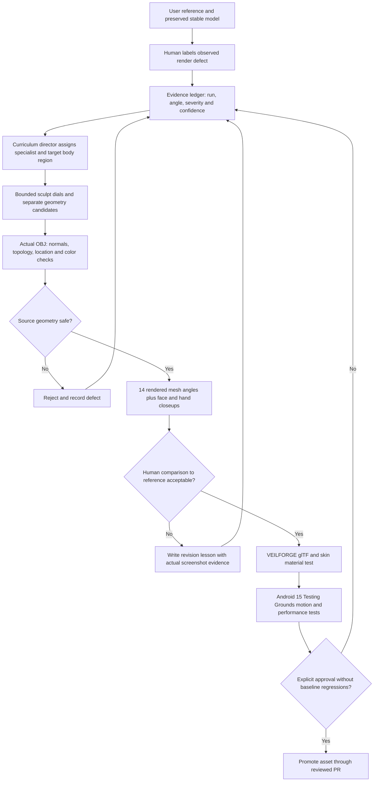

# VEILFORGE Sculpting Skill Map — M26

The long-term goal is a reusable sculpting engine that can improve **anatomy, creatures, architecture, props, environments, materials and rigged objects** through repeatable evidence-based passes. The first implemented adapter targets the unarmored male model in VEILFORGE Testing Grounds. The original Bellwarden armored knight remains an unmodified historical model. Hair is deferred.

## Execution map



## Nine-stage curriculum

| Stage | Sculpting skill | Practical exit criterion |
|---|---|---|
| S1 | Accurate full-body proportions and silhouette | Reference-aligned front, side, back and three-quarter |
| S2 | Facial planes and facial anatomical topology | Credible orbital sockets, lids, nose, mouth and jaw without floating plates |
| S3 | Hands, feet and extremities | Five separated digits per hand, plausible feet and safe attachment angles |
| S4 | Soft tissue, muscle flow, localized surface refinement | Fewer capsule-like bumps, unchanged skin/garment boundaries and stable normals |
| S5 | Topology, retopology and UV masters | Explicit edge-loop review, open boundaries resolved or documented |
| S6 | Layered PBR skin and surfaces | UV-grounded albedo/normal/roughness/AO; natural response in multiple lights |
| S7 | Rigging and animation fidelity | Real dynamic deformation, no clipping or unnatural joint collapse |
| S8 | Android Testing Grounds | One checked APK SHA, synchronized emulators, FPS/resource evidence, playable knight preserved |
| S9 | Reuse across asset families | Same calibrated lesson methods tested on monsters, props, armor, worlds and terrain |

The machine-readable curriculum with owners and checks is in `sculpt_curriculum.json`. The manual failure record lives in `feedback/sculpt_lessons.json`.

## What is implemented now

1. A manually grounded M24/M25 defect ledger, with source Actions run, artifact, camera files, severity, confidence and a decision. No claimed automated image reading.
2. Four specialist proposal tracks: **face**, **surface**, **feet**, and a **full-body** combined pass.
3. Eight bounded, differentiable real-mesh sculpt control zones in the game-side `M26SculptDials` adapter, used only for experimental human candidates.
4. Four proposal strengths per track, including a zero-displacement control. The Testing Grounds workflow actually exports cautious, balanced and assertive geometry variants; baseline remains unchanged.
5. Actual OBJ vertex-by-vertex displacement audit with color preservation, boundary/nonmanifold/degenerate checks and explicit review status. The engine's own `sculpt_learning.py` is reusable beyond the game.
6. Four specialist CI runners produce 12 candidate audit reports, while the VEILFORGE export bridge prepares glTF/skin material evidence. No automatic winner selection or gameplay promotion.
7. Separate optional model-viewer testing on the M26 branch without replacing the playable historical Bellwarden.

## Reproducing the learning step

```bash
python3 -m unittest discover -s veilforge/tests -v
python3 veilforge/sculpt_learning.py map --out inspection_output/sculpt-map
python3 veilforge/sculpt_learning.py propose --focus face --out inspection_output/face-plan.json
python3 veilforge/sculpt_learning.py print-csv --plan inspection_output/face-plan.json --candidate balanced
```

The game-side `HumanVariantCLI` accepts that eight-control CSV as its third argument. Export two OBJ files (unchanged source and candidate), then run `sculpt_learning.py compare --focus face --before ... --after ... --plan ... --out ...`.

## How to teach VEILFORGE another lesson

After inspecting **actual** camera images, record an evidence-backed defect in `feedback/sculpt_lessons.json`. Each record must have a unique identity, known defect code, severity 1–5, confidence 0–1, stage, Action run ID, artifact name, camera filenames, actual evidence type and a review decision. This is data authored after visual review, not an AI guessing from unseen pixels.

A new deform-control type must be bounded in the corresponding geometry adapter and registered in both the curriculum JSON and `sculpt_learning.py` before it can be used; additional defect types also require tests. Existing review outcomes never silently rewrite code.

**Approval is always separate.** A successful numerical or topology check is not evidence of anatomical likeness, photorealism or deployment readiness. The face still requires proper sculpted eyelid sockets, facial loops and authentic nose/jaw transitions; procedural capsule-like plates have not solved that.

## Boundaries and future curriculum development

VEILFORGE's newer geometry tools (including specialized optimization branches) remain undisturbed. This change does not assume every proposed sculpt makes an object look better. Expanded semantic region segmentation, retopology, target-image correspondence and animation-weight reviews are future stages; none are currently claimed implemented.

The curriculum runs when its GitHub workflow is triggered by a relevant source/feedback commit or manually invoked. It is **not** a background autonomous worker continuously changing the repository, and it never runs self-modifying source updates without review.
